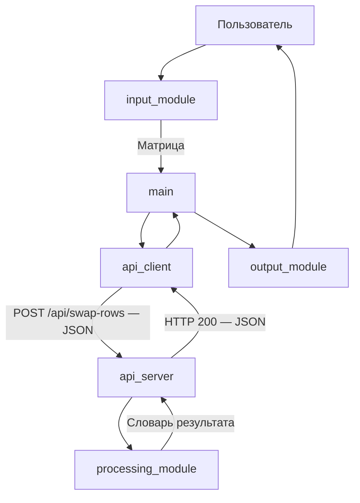

# Документация интеграции

Автор: Савицкий А. А.
Лабораторная работа №3. Вариант 13. Уровень 2.

## Назначение и стратегия

Предметная область сохранена из ЛР 1 и ЛР 2:
перестановка строк вещественной матрицы, содержащих
минимальный и максимальный элементы.

Из варианта 13 использованы нисходящая стратегия
интеграции и REST API через HTTP с форматом JSON.

Сначала управляющий модуль проверен с заглушкой обработки,
затем подключён настоящий обработчик. На уровне 2 добавлены
HTTP-сервер и клиент. Проверен полный цикл от ввода матрицы
до вывода результата, полученного от сервера.

## Архитектура и поток данных



Локальный режим сохранён: main вызывает processing_module
напрямую. В удалённом режиме main использует api_client,
а обработка выполняется на стороне api_server.

## Состав модулей

| Модуль | Назначение |
|---|---|
| main.py | Управление вводом, обработкой и выводом |
| input_module.py | Ввод и проверка матрицы |
| processing_module.py | Поиск экстремумов и перестановка строк |
| output_module.py | Вывод результата |
| api_client.py | Преобразование данных в JSON и HTTP-запрос |
| api_server.py | Приём запроса, вызов обработки и HTTP-ответ |

## Протокол

Адрес по умолчанию: http://127.0.0.1:8000.
Формат сообщений: JSON, кодировка UTF-8.
Content-Type запроса: application/json.
Content-Type ответа: application/json; charset=utf-8.

GET /health проверяет доступность сервера.

Ответ HTTP 200:

```json
{"status": "ok"}
```

POST /api/swap-rows выполняет обработку матрицы.
Запрос должен содержать Content-Length.
Максимальный размер тела запроса — 1000000 байт.

Пример запроса:

```json
{"matrix": [[1, 2], [-5, 6], [9, 12]]}
```

Пример ответа HTTP 200:

```json
{
  "matrix": [[1, 2], [9, 12], [-5, 6]],
  "min_value": -5,
  "max_value": 12,
  "min_row": 1,
  "max_row": 2
}
```

min_row и max_row — индексы строк в исходной матрице,
начиная с нуля. Вывод пользователю прибавляет единицу.

## Структуры данных и mapping

| Источник | Поле или объект | Преобразование | Получатель |
|---|---|---|---|
| Ввод | Строки чисел | split и float | Матрица list[list[float]] |
| main | matrix | Упаковка в объект с полем matrix | api_client |
| api_client | matrix | json.dumps и UTF-8 | JSON-запрос |
| api_server | Тело запроса | UTF-8 и json.loads, извлечение matrix | processing_module |
| processing_module | matrix | Копирование и перестановка строк | Поле matrix результата |
| processing_module | min_value, max_value | Числа JSON | Одноимённые поля ответа |
| processing_module | min_row, max_row | Целые числа JSON, индексация с нуля | Одноимённые поля ответа |
| api_client | JSON-ответ | json.loads | Словарь результата в main |
| output_module | min_row, max_row | Прибавление единицы | Номера исходных строк на экране |
| output_module | matrix | Форматирование чисел | Строки матрицы на экране |

Матрица должна быть непустой и прямоугольной.
Элементы — конечные числа; логические значения запрещены.
При повторении экстремума выбирается первое вхождение
при просмотре по строкам. Если минимум и максимум находятся
в одной строке, матрица остаётся прежней.
Исходный объект матрицы не изменяется.

## Обработка ошибок

Ошибки API возвращаются в формате:

```json
{"error": "Описание ошибки"}
```

| HTTP-код | Причина |
|---|---|
| 200 | Успешный запрос |
| 400 | Некорректный JSON, UTF-8, структура запроса или длина тела |
| 404 | Неизвестный маршрут |
| 408 | Истекло время чтения тела запроса |
| 413 | Превышен допустимый размер тела |
| 415 | Неверный Content-Type |
| 422 | Недопустимая матрица |

Клиент преобразует ошибки HTTP и недоступность сервера
в ValueError. Управляющий модуль выводит сообщение
и завершает работу с кодом 1.

## Запуск

Из корня проекта:

```bash
python src/main.py
```

Для REST-режима запустить сервер в первом окне:

```bash
python src/api_server.py
```

Во втором окне:

```bash
python src/main.py --remote
```

Другой порт:

```bash
python src/api_server.py --port 8001
python src/main.py --remote --url http://127.0.0.1:8001
```

Сервер использует стандартную библиотеку Python
и слушает только локальный адрес 127.0.0.1.

## Источники

- https://docs.python.org/3/library/http.server.html
- https://docs.python.org/3/library/urllib.request.html
- https://docs.python.org/3/library/json.html
- https://docs.python.org/3/library/unittest.html
