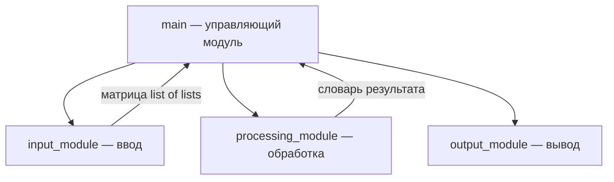

# Интеграция модулей — уровень 1

Автор: Савицкий А. А.
Лабораторная работа №3. Вариант 13.

## Назначение проекта

Программа меняет местами строки вещественной матрицы,
содержащие минимальный и максимальный элементы.
Предметная область сохранена из ЛР 1 и ЛР 2.
Из варианта 13 взяты нисходящая стратегия интеграции
и REST API, который будет реализован на уровне 2.

## Состав модулей

| Модуль | Назначение |
|---|---|
| main.py | Управление последовательностью обработки |
| input_module.py | Ввод и проверка размеров и элементов |
| processing_module.py | Поиск экстремумов и перестановка строк |
| output_module.py | Вывод матрицы и сведений об экстремумах |

## Схема интеграции



Поток данных: пользователь → ввод → main → обработка →
main → вывод → пользователь.

## Стратегия и порядок интеграции

Выбрана нисходящая стратегия согласно варианту 13.
Проверка начинается с управляющего модуля, определяющего
порядок вызовов подчинённых модулей.

1. Проверена работа main с настоящими модулями ввода
   и вывода и заглушкой обработки.
2. Заглушка заменена настоящим модулем обработки.
3. Проверены совместная работа модулей, ошибки ввода
   и граничные случаи.

Заглушка реализована в tests/test_top_down.py через
unittest.mock.patch. Она возвращает заранее заданный
результат. Тест проверяет передачу исходной матрицы
в обработку и вывод полученного результата.
Отдельный драйвер не требуется: вызовы организует main.

## Интерфейсы

| Функция | Вход | Результат |
|---|---|---|
| read_matrix() | Ввод пользователя | Непустая прямоугольная матрица конечных чисел |
| swap_extreme_rows(matrix) | Матрица | Словарь с matrix, min_value, max_value, min_row, max_row |
| print_result(result) | Словарь результата | Вывод в терминал |
| main() | Нет аргументов | Код завершения 0 или 1 |

Внутри программы индексы строк начинаются с нуля.
Пользователю номера строк выводятся с единицы.
При повторяющихся экстремумах выбирается первое
вхождение при просмотре матрицы по строкам.
Если оба экстремума находятся в одной строке,
матрица не изменяется. Исходная матрица не модифицируется:
обработка возвращает копию с переставленными строками.

## Отладка и результаты

Исходная программа завершалась с исключением при нулевом
числе строк и вводе букв вместо чисел. Добавлены проверки
размеров, числовых значений и повторный запрос ввода.

Команда проверки:

```bash
python -m unittest discover -s tests -v
```

Результат: Ran 8 tests, OK.

Проверены:
- управление с заглушкой обработки;
- полный цикл с настоящими модулями;
- исправление ошибочного ввода;
- матрица из одного элемента;
- экстремумы в одной строке;
- повторяющиеся экстремумы и сохранность исходных данных;
- отклонение недопустимых матриц;
- прерывание ввода.

Для матрицы [[1,2,3,4],[-5,6,7,8],[9,10,11,12]]
получен результат [[1,2,3,4],[9,10,11,12],[-5,6,7,8]].

## Вывод

Выполнена нисходящая интеграция управляющего модуля
с модулями ввода, обработки и вывода. Передача данных
и обработка ошибок проверены автоматическими тестами.
